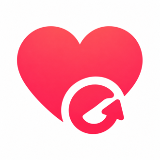
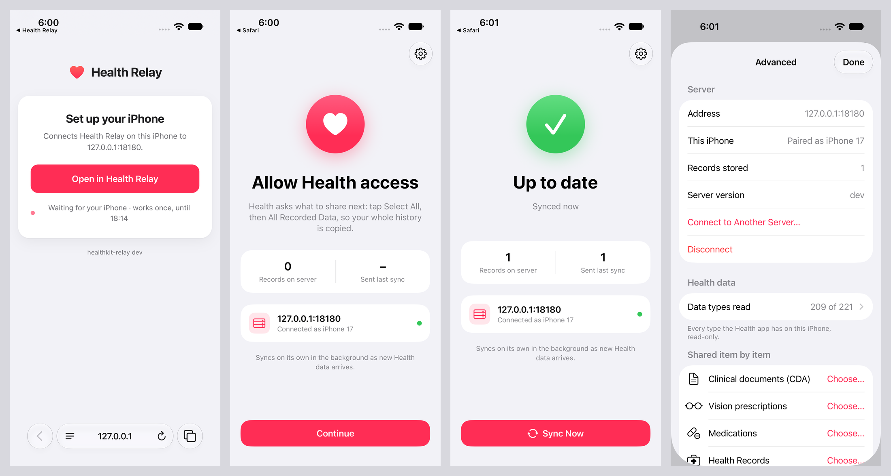
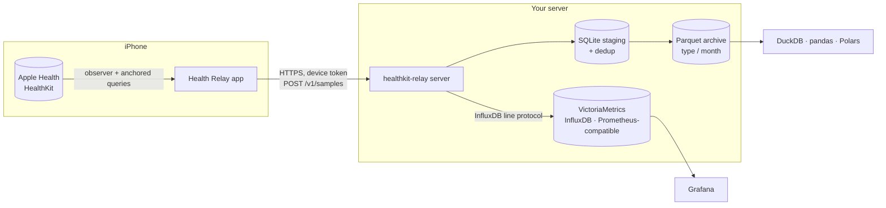

<p align="center">
  
</p>

<h1 align="center">Health Relay</h1>

<p align="center">
  <b>Your Apple Health data, on a server you own. Free, open source, no strings attached.</b>
</p>

<p align="center">
  <a href="https://github.com/leblancfg/healthkit-relay/actions/workflows/ci.yml"></a>
  <a href="https://github.com/leblancfg/healthkit-relay/releases/latest"></a>
  <a href="https://github.com/leblancfg/healthkit-relay/pkgs/container/healthkit-relay"></a>
  <a href="LICENSE"></a>
  <a href="https://leblancfg.com/healthkit-relay/"></a>
</p>

Your iPhone and Apple Watch record a lot about you: every heartbeat, every night of sleep,
every run. That history lives in the Health app on your iPhone. Health Relay copies it to a
**self-hosted server**: a small program you run on a computer at home, a NAS or a rented
server.

Install the iPhone app and pair it with your server once. From then on, the app sends new
health data to your server: it syncs in the background several times a day; open the app to
sync right away. Your whole history, years of it, sits in plain files that you can keep,
chart, query or delete.

- **Your data stays with you.** It travels from your iPhone straight to your server, and
  stays there.
- **Free and open source.** The app and the server are MIT-licensed, with every feature
  included.
- **Hands-off.** After the first sync, new data arrives on its own.
- **Everything, exactly as recorded.** Every type of data Apple Health keeps, with its source,
  device and details, so the data you decide matters later is already there.
- **Ready to use.** Chart it in Grafana, query it from a notebook or a script, or keep it as a
  backup you control.
- **Runs on what you already have.** A NAS, a Raspberry Pi, a home server or a small VPS. The
  server is one program that keeps everything in files.

**[Documentation](https://leblancfg.com/healthkit-relay/)** ·
[Quick start](#quick-start) ·
[Setup guides](https://leblancfg.com/healthkit-relay/setup/) ·
[FAQ](#faq)

## Features

Health Relay is an open-source **HealthKit sync and backup** tool. The iPhone app reads
everything in Apple Health (heart rate, HRV, sleep stages, steps, workouts with GPS routes,
ECG recordings, blood pressure, cycle tracking, medications and the rest)
and uploads it in the background to a single Go binary or Docker container. The server keeps
a lossless archive in **Parquet** files you can query with **DuckDB**, and can forward the
numbers as InfluxDB line protocol to **Prometheus-compatible stores** such as
**VictoriaMetrics** or **InfluxDB**, so your Apple Watch data shows up in **Grafana**. It
replaces the Health app's manual "Export All Health Data" zip with a continuous, private
sync.

- **Everything HealthKit has.** The list of data types is generated from the iOS SDK at
  build time: all quantity and category types, workouts (activities, events, statistics,
  every GPS point of the route), heartbeat series, ECG voltages, audiograms, blood pressure
  and food correlations, State of Mind, GAD-7/PHQ-9, medications, vision prescriptions,
  activity rings and characteristics (and Health Records, in builds of your own: see
  [ios/README.md](ios/README.md#health-records)). Building with a newer Xcode
  adds the types of that iOS version.
- **Continuous and incremental.** The first sync uploads your whole history. After that, the
  app syncs in the background several times a day; open the app to sync right away.
  Deletions sync too.
- **Lossless.** Every sample is stored exactly as sent, with its source, device and metadata,
  plus Apple's own serialized copy (`NSKeyedArchiver`) for most kinds of data.
- **Each record stored once.** The server stores a batch whole or not at all and skips
  records it already has. The app moves on only once the server confirms a batch.
- **Query it like a data lake.** Parquet files split by type and month: open them in DuckDB,
  pandas, Polars or Spark.
- **Query API with OpenAPI docs.** An optional read-only HTTP API: daily and hourly totals
  and averages (steps counted once when both the Apple Watch and the iPhone recorded them,
  sleep stages per night), individual samples and the list of types. It is described at
  `/openapi.json` and browsable at `/docs`. Dashboards, scripts and AI agents use it with a
  **read token**.
- **Dashboards.** Numeric samples go to VictoriaMetrics, InfluxDB or anything that accepts
  line protocol. Build Grafana dashboards for resting heart rate, HRV, sleep, VO2 max or
  steps.
- **Pairing with a QR code.** Scan a setup code from the server's setup page. Each iPhone
  gets its own token, which you can revoke. The app can erase everything it uploaded.
- **Light to run.** One static binary that keeps its data in files, `/metrics` for
  Prometheus, builds for amd64 and arm64.

## Screenshots

<p align="center">
  
</p>

<!-- More welcome: a Grafana dashboard, the setup page with its QR code. Put them in docs/assets/screenshots/. -->

## How it works



1. The app registers a HealthKit observer per data type and asks iOS for background
   delivery, a background app refresh and a processing task while the iPhone charges, and
   syncs once more when you leave it. iOS picks the moments. An anchored query returns what
   changed since the last confirmed upload: new samples and deletions.
2. The app posts batches, retrying with backoff. It moves its position forward only when the
   server confirms the batch is safely on disk, so an interrupted first upload resumes where
   it stopped. An upload still under way when iOS suspends the app finishes in the
   background, and iOS wakes the app when it is done.
3. The server skips records it already has, stages the rest and writes them to the archive,
   then forwards numeric samples to your time-series database if you set one up. The
   archive is the source of truth; the time-series database holds a copy of the numbers for
   charts.

## Quick start

You need a computer that stays on (a home server, a NAS, a Raspberry Pi) with Docker, and an
iPhone. The [setup guides](https://leblancfg.com/healthkit-relay/setup/) cover installing
without Docker, and NixOS, macOS, NAS and Raspberry Pi. The
[glossary](https://leblancfg.com/healthkit-relay/glossary/) explains each term.

1. **Start the server.** On that computer, run these commands. Replace `192.168.1.10` with
   the computer's address on your network: this is the **server address**, the one the
   iPhone uses to reach the server.

   ```sh
   mkdir -p healthkit-relay && cd healthkit-relay
   curl -fsSLO https://raw.githubusercontent.com/leblancfg/healthkit-relay/main/docker-compose.yml
   mkdir -p data
   printf 'HKR_USER=%s\nHKR_PUBLIC_URL=%s\n' "$(id -u):$(id -g)" http://192.168.1.10:8080 > .env
   docker compose up -d
   ```

2. **Save the admin token.** Run `docker compose logs relay`. The log shows the **admin
   token**, a long random string, and the address of the setup page. The admin token is the
   password of your server, and the log shows it only on the first start: save it in a
   password manager now.

3. **Install the iPhone app.** Get **Health Relay** from the App Store. To build it
   yourself instead (a Mac with Xcode and a paid Apple Developer account), follow
   [ios/README.md](ios/README.md).

4. **Pair the iPhone.** On a computer on the same network, open the **setup page**,
   `http://192.168.1.10:8080/setup`, and sign in with the admin token. The page shows a
   **setup code** as a QR code. Point the iPhone's Camera at it, tap **Open in Health
   Relay**, then **Connect**. The setup page shows **iPhone paired**. (To show the QR code
   in the terminal instead, run `docker compose exec relay healthkit-relay pair`.)

5. **Allow Health access.** In the app, tap **Continue** under **Allow Health access**. Health
   asks what Health Relay may read: turn on every category, then tap **Allow**. The first sync
   starts. The setup page lists your iPhone under **Paired devices**, and the app shows
   **Up to date** with the number of **Records on server**.

To sync away from home too, [put the server behind HTTPS](https://leblancfg.com/healthkit-relay/networking/).
Tailscale is the easiest way.

## Privacy

- Your health data goes to one place: the server you pair the app with.
- The app asks for **read** access to Apple Health.
- Each iPhone has its own token, stored in its Keychain. The server keeps a hash of each
  token and can revoke it. Pairing and the setup page answer devices on private networks
  only, by default.
- `/healthz`, `/metrics`, `/openapi.json` and `/docs` are public and hold status and API
  descriptions. The optional query API answers with health data to a read token or the
  admin token.
- Your data is plain files on your disk: easy to back up, easy to delete.

More in [Security & privacy](https://leblancfg.com/healthkit-relay/security/).

> [!IMPORTANT]
> **Not a medical device.** Health Relay copies data. Talk to a health professional about
> medical questions. Values may be incomplete, delayed or wrong. See [DISCLAIMER.md](DISCLAIMER.md).

## FAQ

<details>
<summary><b>How is this different from the Health app's "Export All Health Data"?</b></summary>

The built-in export makes one zip of a large XML file, by hand, each time you want new data.
Health Relay syncs on its own, in the background, a little at a time, deletions included, and
stores the data by type, ready to query.
</details>

<details>
<summary><b>How often does it sync?</b></summary>

Health Relay syncs in the background several times a day; open the app to sync right away.
iOS picks the moments: soon after new Health data arrives (heart rate, steps, sleep), at its
background app refresh, while the iPhone charges, and for about 30 seconds after you leave
the app. iPhone keeps Health data locked while the phone is locked, so these syncs happen
after you unlock it: a wake while it is locked notes that a sync is owed, and the first one
after an unlock sends everything since. Low Power Mode, Background App Refresh turned off,
and swiping the app away in the app switcher hold background syncs back until you open the
app again.
</details>

<details>
<summary><b>Do I need an Apple Developer account?</b></summary>

No: Health Relay is on the App Store. Building the app from source yourself takes one,
since Apple signs HealthKit apps only for paid Apple Developer Program members.
</details>

<details>
<summary><b>Where does my data go?</b></summary>

From your iPhone to the server address you pair the app with, and from there wherever you
send it: Grafana, a backup. You run every part of Health Relay yourself.
</details>

<details>
<summary><b>Does it work with Apple Watch data?</b></summary>

Yes. The Apple Watch saves its data into Apple Health on the iPhone, and Health Relay reads it
from there: heart rate, HRV, resting heart rate, VO2 max, sleep stages, workouts and routes,
ECGs, blood oxygen, wrist temperature and so on.
</details>

<details>
<summary><b>Can I use Prometheus, InfluxDB, VictoriaMetrics or Grafana?</b></summary>

Yes. The server can forward numbers to anything that accepts InfluxDB line protocol over
HTTP: VictoriaMetrics, InfluxDB 1.x/2.x, or Telegraf's HTTP listener in front of Prometheus.
Forwarding is optional; the Parquet archive always has everything.
</details>

<details>
<summary><b>Does it need to be reachable from the internet?</b></summary>

The iPhone syncs whenever it can reach the server. With the server on your home network,
it syncs while you are at home. To sync from anywhere, use Tailscale or another VPN. See
[Networking & HTTPS](https://leblancfg.com/healthkit-relay/networking/).
</details>

<details>
<summary><b>Android, Google Fit, Health Connect?</b></summary>

Health Relay works with Apple Health on the iPhone. The server's upload API is documented in
[server/README.md](server/README.md), so another app could send data to it.
</details>

<details>
<summary><b>Several people, several iPhones?</b></summary>

Pair as many iPhones as you like. Each one is a paired device with its own token, listed on
the setup page. Records keep the source and device they came from.
</details>

## Repository layout

```
server/     Go server: receiver, archive (SQLite staging, Parquet), pairing, forwarding
ios/        SwiftUI iPhone app (XcodeGen spec in project.yml)
docs/       documentation site (MkDocs Material)
flake.nix   Nix package, NixOS module (nix/) and its VM test
packaging/  systemd unit shipped in the release archives
scripts/    smoke-test.sh, the end-to-end check every install path runs in CI
Makefile    server-test, server-build, ios-build, ios-test
```

API, flags and archive details: [server/README.md](server/README.md). Query API:
[docs/query-api.md](docs/query-api.md). DuckDB views: [`server/sql/views.sql`](server/sql/views.sql).
App internals: [ios/README.md](ios/README.md). Upgrading from 0.4 or earlier: stop the
server and run `healthkit-relay migrate -archive-dir <archive>` once.

## Contributing

Bug reports, data types that look wrong and setup guides for more platforms are all welcome.
See [CONTRIBUTING.md](CONTRIBUTING.md) and the [Code of Conduct](CODE_OF_CONDUCT.md). Report
security issues privately, as described in [SECURITY.md](SECURITY.md).

## License

[MIT](LICENSE). Apple, Apple Health, HealthKit, Apple Watch and iPhone are trademarks of
Apple Inc. This project is not affiliated with or endorsed by Apple.
