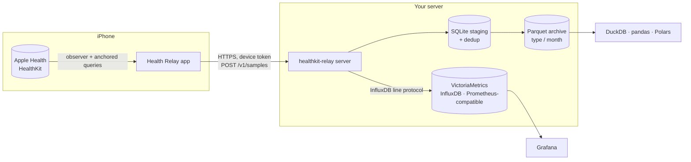

<p align="center">
  
</p>

<h1 align="center">Health Relay</h1>

<p align="center">
  <b>Your Apple Health data, on a server you own. Free, open source, no strings attached.</b>
</p>

<p align="center">
  <a href="https://github.com/leblancfg/healthkit-relay/actions/workflows/ci.yml"></a>
  <a href="https://github.com/leblancfg/healthkit-relay/releases/latest"></a>
  <a href="https://github.com/leblancfg/healthkit-relay/pkgs/container/healthkit-relay"></a>
  <a href="LICENSE"></a>
  <a href="https://leblancfg.com/healthkit-relay/"></a>
</p>

Your iPhone and Apple Watch know a lot about you: every heartbeat, every night of sleep, every
run. That history lives inside the Health app, and the apps that get it out want a
subscription. Health Relay gets it out for good, onto a **self-hosted server** that you run.

Install the free iPhone app, pair it with your server, and forget about it. From then on your
health history keeps itself up to date in the background, years of it, in plain files that
are yours to keep, chart, query or delete.

- **Own your data.** It goes from your phone to your server and nowhere else. No account, no
  cloud, no analytics, nobody in the middle.
- **Free, forever.** The app and the server are free and open source. No premium tier, no
  subscription, no features held back. Ever.
- **Set it and forget it.** After the first sync, new data arrives on its own. Nothing to
  export, nothing to remember.
- **All of it, exactly as recorded.** Every kind of data Apple Health keeps, nothing trimmed,
  so you never lose something you only later decide matters.
- **Yours to use.** Chart it in Grafana, dig into it from a notebook, or simply keep a backup
  that doesn't depend on anyone else.
- **Runs on what you already have.** A NAS, a Raspberry Pi, a home server or a small VPS: one
  small program, no database to look after.

**[Documentation](https://leblancfg.com/healthkit-relay/)** ·
[Quick start](#quick-start) ·
[Setup guides](https://leblancfg.com/healthkit-relay/setup/) ·
[FAQ](#faq)

## Features

Health Relay is an open-source **HealthKit sync and backup** tool. The iPhone app reads
everything in Apple Health (heart rate, HRV, sleep stages, steps, workouts with GPS routes,
ECG recordings, blood pressure, cycle tracking, medications, Health Records and the rest)
and uploads it in the background to a single Go binary or Docker container. The server keeps
a lossless archive in **Parquet** files you can query with **DuckDB**, and forwards the
numbers as InfluxDB line protocol to **Prometheus-compatible stores** such as
**VictoriaMetrics** or **InfluxDB**, so your Apple Watch data shows up in **Grafana**: a
private, free alternative to paid Apple Health exporter apps and to the manual `export.zip`
XML dump.

- **Everything HealthKit has.** The list of data types is generated from the iOS SDK at
  build time: all quantity and category types, workouts (activities, events, statistics,
  every GPS point of the route), heartbeat series, ECG voltages, audiograms, blood pressure
  and food correlations, State of Mind, GAD-7/PHQ-9, medications, vision prescriptions,
  clinical records (FHIR), activity rings and characteristics. A newer Xcode means new types,
  with no code change.
- **Continuous and incremental.** The first sync uploads your whole history; after that iOS
  wakes the app in the background as new data lands (about hourly). Deletions sync too.
- **Lossless.** Every sample is stored exactly as sent, with source, device and metadata,
  plus the raw `NSKeyedArchiver` archive for most kinds, so nothing is dropped for want of a
  field.
- **Nothing lost, nothing duplicated.** Batches are stored whole or not at all; the app only
  moves on once the server confirms, and the server ignores records it already has.
- **Query it like a data lake.** Parquet partitioned by type and month: open it in DuckDB,
  pandas, Polars or Spark.
- **Dashboards.** Numeric samples go to VictoriaMetrics, InfluxDB or anything that accepts
  line protocol; build Grafana dashboards for resting heart rate, HRV, sleep, VO2 max or
  steps.
- **One-tap pairing.** Scan a QR code from the setup page; each iPhone gets its own
  revocable token. Erase all server data from the app if you want out.
- **Small and boring to run.** One static binary, no database server to manage, `/metrics`
  for Prometheus, runs on amd64 and arm64.

## Screenshots

<p align="center">
  
</p>

<!-- More welcome: a Grafana dashboard, the setup page with its QR code. Put them in docs/assets/screenshots/. -->

## How it works



1. The app registers a HealthKit observer per data type and asks iOS for background
   delivery. An anchored query returns what changed since the last confirmed upload: new
   samples and deletions.
2. Batches are posted with retries and backoff. The app's position only advances when the
   server confirms the batch is durably stored, so an interrupted first upload resumes where
   it stopped.
3. The server deduplicates, stages and writes everything to the archive, then forwards
   numeric samples to your time-series database if you configured one. The archive is the
   source of truth; the metrics database is just a view.

## Quick start

**Server** (Docker; see the [setup guides](https://leblancfg.com/healthkit-relay/setup/)
for a binary, systemd, NixOS, macOS, NAS or Raspberry Pi):

```sh
mkdir -p healthkit-relay && cd healthkit-relay
curl -fsSLO https://raw.githubusercontent.com/leblancfg/healthkit-relay/main/docker-compose.yml
mkdir -p data
(umask 077; head -c 32 /dev/urandom | base64 > token)   # the admin token
printf 'HKR_USER=%s\nHKR_PUBLIC_URL=%s\n' "$(id -u):$(id -g)" http://192.168.1.10:8080 > .env
docker compose up -d
```

`HKR_PUBLIC_URL` is the address your iPhone uses to reach the server.

**iPhone app.** Not on the App Store yet: build it with Xcode and a paid Apple Developer
account (HealthKit requires one). See [ios/README.md](ios/README.md).

**Pair.** Run `docker compose exec relay healthkit-relay pair` for a QR code in the
terminal, or open `http://192.168.1.10:8080/setup` in a browser on the same network and enter
the token; scan the QR code with the iPhone's Camera. Allow Health access once and the first
sync starts. For syncing away from home,
[put it behind HTTPS](https://leblancfg.com/healthkit-relay/networking/) (Tailscale is
the easiest).

## Privacy

- Your health data goes to the server you run and nowhere else. No analytics, no crash
  reporting, no third-party SDKs, no vendor account.
- The app asks for **read** access only and never writes to Apple Health.
- Each iPhone has its own token, stored in the Keychain; the server keeps only a hash and
  can revoke it. Pairing and the setup page answer private networks only, by default.
- `/healthz` and `/metrics` expose no health data.
- Your data is plain files on your disk: easy to back up, easy to delete.

More in [Security & privacy](https://leblancfg.com/healthkit-relay/security/).

> [!IMPORTANT]
> **Not a medical device.** Health Relay copies data; it does not diagnose, treat or
> monitor any condition, and it is not a substitute for professional medical advice.
> Values may be incomplete, delayed or wrong. See [DISCLAIMER.md](DISCLAIMER.md).

## FAQ

<details>
<summary><b>How is this different from the Health app's "Export All Health Data"?</b></summary>

The built-in export is a manual, one-off zip of a large XML file that you have to redo to
get anything new, and it does not tell you what was deleted since last time. Health Relay
syncs continuously and incrementally, in the background, includes deletions, and stores the
data typed and ready to query.
</details>

<details>
<summary><b>Do I need an Apple Developer account?</b></summary>

Today, yes: the app is built from source, and HealthKit apps can only be signed with a paid
Apple Developer Program membership. A TestFlight or App Store build may come later.
</details>

<details>
<summary><b>Does my data go through any cloud?</b></summary>

No. The app talks only to the server address you pair it with. There is no Health Relay
service, account or telemetry.
</details>

<details>
<summary><b>Does it work with Apple Watch data?</b></summary>

Yes. Apple Watch writes into Apple Health on the iPhone, and Health Relay reads it from
there: heart rate, HRV, resting heart rate, VO2 max, sleep stages, workouts and routes, ECGs,
blood oxygen, wrist temperature and so on. There is no separate watch app.
</details>

<details>
<summary><b>Can I use Prometheus, InfluxDB, VictoriaMetrics or Grafana?</b></summary>

Anything that accepts InfluxDB line protocol over HTTP works as a forwarding target:
VictoriaMetrics, InfluxDB 1.x/2.x, or Telegraf's HTTP listener in front of Prometheus.
Forwarding is optional; the Parquet archive always has everything.
</details>

<details>
<summary><b>Does it need to be reachable from the internet?</b></summary>

No. The phone syncs whenever it can reach the server, so a LAN-only setup works (syncs
happen at home). For syncing from anywhere without opening ports, use Tailscale or another
VPN. See [Networking & HTTPS](https://leblancfg.com/healthkit-relay/networking/).
</details>

<details>
<summary><b>Android, Google Fit, Health Connect?</b></summary>

Not supported. The server's API is documented, so another client could send data to it.
</details>

<details>
<summary><b>Several people, several iPhones?</b></summary>

Pair as many iPhones as you like; each gets its own token and appears in the device list.
Records keep the source and device they came from.
</details>

## Repository layout

```
server/     Go server: receiver, archive (SQLite staging, Parquet), pairing, forwarding
ios/        SwiftUI iPhone app (XcodeGen spec in project.yml)
docs/       documentation site (MkDocs Material)
flake.nix   Nix package, NixOS module (nix/) and its VM test
packaging/  systemd unit shipped in the release archives
scripts/    smoke-test.sh, the end-to-end check every install path runs in CI
Makefile    server-test, server-build, ios-build, ios-test
```

API, flags and archive details: [server/README.md](server/README.md); DuckDB views in
[`server/sql/views.sql`](server/sql/views.sql). App internals: [ios/README.md](ios/README.md).
Upgrading from 0.4 or earlier: stop the server and run
`healthkit-relay migrate -archive-dir <archive>` once.

## Contributing

Bug reports, data types that look wrong, setup guides for platforms we missed: all welcome.
See [CONTRIBUTING.md](CONTRIBUTING.md) and the [Code of Conduct](CODE_OF_CONDUCT.md). Report
security issues privately, as described in [SECURITY.md](SECURITY.md).

## License

[MIT](LICENSE). Apple, Apple Health, HealthKit, Apple Watch and iPhone are trademarks of
Apple Inc. This project is not affiliated with or endorsed by Apple.
