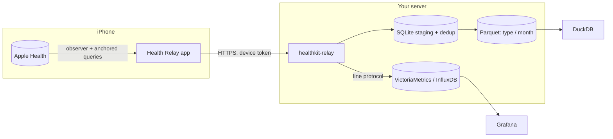

# Health Relay

**Self-hosted Apple Health export: sync your iPhone and Apple Watch health data to a server
you own, continuously, with no cloud in between.**

Health Relay is an open-source HealthKit sync and backup tool in two parts:

- **An iPhone app** that reads everything in Apple Health (read-only) and uploads new
  samples and deletions in the background: heart rate, HRV, resting heart rate, sleep
  stages, steps, VO2 max, workouts with every GPS point of their routes, ECG voltages,
  blood pressure, cycle tracking, medications, Health Records (FHIR) and the rest.
- **A server**, one static Go binary or Docker image, that pairs phones with a QR code,
  archives every record losslessly in Parquet files you can query with DuckDB, and
  forwards the numbers as InfluxDB line protocol to VictoriaMetrics, InfluxDB or any
  Prometheus-compatible store, for Grafana dashboards.

No account, no analytics, no vendor cloud: a private, free alternative to paid Apple Health
exporter apps and to the manual XML export.

## How it works

1. The app watches every HealthKit type and asks iOS to wake it when new data lands (about
   hourly). Each sync sends only what changed since the last confirmed upload.
2. The server stores a batch entirely or not at all and answers only once it is on disk; the
   app moves on only then. Retries never duplicate anything.
3. Numeric samples are forwarded to your time-series database. The archive keeps
   everything, including what has no number (routes, ECGs, documents).

## Where to go next

- **[Quick start](quickstart.md)**: a server in Docker and a paired iPhone in ten minutes.
- **[Setup guides](setup/index.md)**: Docker, systemd, NixOS, macOS, NAS, Raspberry Pi.
- **[Networking & HTTPS](networking.md)**: Tailscale, Caddy, or LAN only.
- **[Data model & querying](data.md)**: the Parquet layout and DuckDB recipes.
- **[Grafana](grafana.md)**: dashboards from VictoriaMetrics or InfluxDB.
- **[Security & privacy](security.md)**: what never leaves your server.

!!! warning "Not a medical device"
    Health Relay copies data; it does not diagnose, treat or monitor any condition and is
    not a substitute for professional medical advice. Values may be incomplete, delayed or
    wrong. Apple, Apple Health, HealthKit, Apple Watch and iPhone are trademarks of Apple
    Inc.; this project is not affiliated with Apple.
