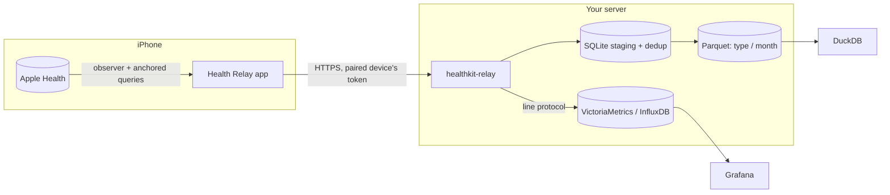

# Health Relay

**Self-hosted Apple Health export: your iPhone and Apple Watch health data, synced
continuously to a server you own.**

Health Relay is an open-source HealthKit sync and backup tool in two parts:

- **An iPhone app** that reads everything in Apple Health (read-only) and uploads new
  samples and deletions in the background: heart rate, HRV, resting heart rate, sleep
  stages, steps, VO2 max, workouts with every GPS point of their routes, ECG voltages, blood
  pressure, cycle tracking, medications and the rest. Your Apple Watch's data reaches the
  app through the iPhone's Health app. (Clinical Health Records are read only by builds of
  your own, see ios/README.md.)
- **A server**, one Go program, published as a Docker image and as a binary for Linux, macOS
  and FreeBSD. It pairs iPhones with a QR code, keeps every record in Parquet files you can
  query with DuckDB, and can forward the numbers to VictoriaMetrics, InfluxDB or any
  Prometheus-compatible database, for Grafana dashboards.

Your data goes from your iPhone to your server, and only there. Health Relay is free: an
alternative to paid Apple Health exporter apps and to the XML export of the Health app.

## How it works

1. The app watches every HealthKit type and syncs in the background several times a day, when
   iOS wakes it; open the app to sync right away. Each sync sends only what changed since the
   last upload the server confirmed.
2. The server stores each batch whole and answers once it is on disk. The app moves on only
   then, so a batch sent twice is stored once.
3. If you set up a time-series database, the server forwards numeric samples to it, such as
   heart rate and steps. The archive, the server's folder of Parquet files, keeps everything,
   including records without a number: routes, ECGs, documents.

New to self-hosting? The [glossary](glossary.md) explains the words these pages use
(server address, setup page, admin token...), each with an example.

## Where to go next

- **[Quick start](quickstart.md)**: a server in Docker and a paired iPhone, step by step.
- **[Setup guides](setup/index.md)**: Docker, systemd, NixOS, macOS, NAS, Raspberry Pi.
- **[Networking & HTTPS](networking.md)**: Tailscale, Caddy, or your home network only.
- **[Data model & querying](data.md)**: the Parquet layout and DuckDB recipes.
- **[Grafana](grafana.md)**: dashboards from VictoriaMetrics or InfluxDB.
- **[Security & privacy](security.md)**: what stays on your server, and how.

!!! warning "Not a medical device"
    Health Relay copies data; it does not diagnose, treat or monitor any condition and is
    not a substitute for professional medical advice. Values may be incomplete, delayed or
    wrong. Apple, Apple Health, HealthKit, Apple Watch and iPhone are trademarks of Apple
    Inc.; this project is not affiliated with Apple.
