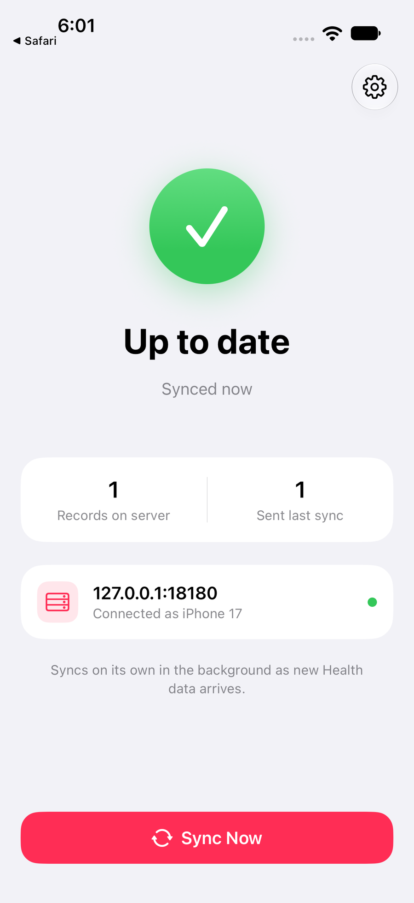

# Pairing a phone

Pairing gives an iPhone a token of its own, so the server token (the admin credential) never
leaves the server.

{ width="300" align="right" }

## From the setup page

1. Open `https://<server>/setup` (or `http://<server-ip>:8080/setup` on a LAN) on a
   computer and enter the server token. The sign-in lasts an hour.
2. If more than one address is offered, pick the one the phone will use.
3. Point the iPhone's Camera at the QR code and tap **Open in Health Relay**. On the iPhone
   itself, tap the page's **Open in Health Relay** button instead.
4. The page turns into *iPhone connected*. In the app, allow Health access once: select
   everything, then confirm.

The first sync uploads your whole history. Keep the app open for it; it can take a while
with years of Apple Watch data. After that, iOS wakes the app in the background as new data
arrives (about hourly; Low Power Mode and force-quitting the app pause it). **Sync Now**, or
pulling down on the main screen, syncs at once.

## From the terminal

```sh
healthkit-relay pair -token-file ./token -public-url https://health.example.com
```

prints the QR code in the terminal. To send a link to your phone instead (by message or
email to yourself), make it last longer:

```sh
healthkit-relay pair -token-file ./token -valid 2h
```

## Managing devices

The setup page lists paired iPhones with a **Revoke** button. From the terminal:

```sh
healthkit-relay devices -token-file ./token
healthkit-relay revoke  -token-file ./token 3f9a1c2e
```

Revoking takes effect at once: the app sees it at its next sync and asks to be set up again.
Pairing again from the same iPhone replaces its previous token.

## How setup codes work

- A setup code is 120 random bits, works once and expires after 15 minutes (`-valid` up to a
  day). Codes live in memory only; restarting the server voids them.
- The QR code holds `healthrelay://pair?server=<url>&code=<code>`, a link the app registers.
- The app exchanges the code for a 256-bit device token. The server stores only its SHA-256,
  with the device's name and model.
- `/setup` and pairing answer only private networks by default (`-setup-from private`: loopback,
  LAN, Tailscale). `-setup-from off` disables the page; the terminal commands still work.
- Loopback and link-local addresses are never put in a code, since a phone cannot reach them.
  If the page finds no usable address it says so and shows no code: set `-public-url`.

## Manual setup

In the app, **Enter Server Details Instead** takes an address and the server token; the app
swaps that token for a device token of its own straight away.

## Leaving

In the app, **Advanced** › **Disconnect** forgets the server on the phone. **Erase Server Data and Start Over**
deletes what this iPhone uploaded, for good, and then uploads it again. To delete it without
a new upload, revoke the device, then erase its data with the server token:

```sh
curl -X DELETE -H "Authorization: Bearer $(cat token)" \
  "http://127.0.0.1:8080/v1/data?confirm=erase&device=<device id>"
```

To delete everything, stop the server and delete the data directory. See [Backups](backups.md) before
you do either.
